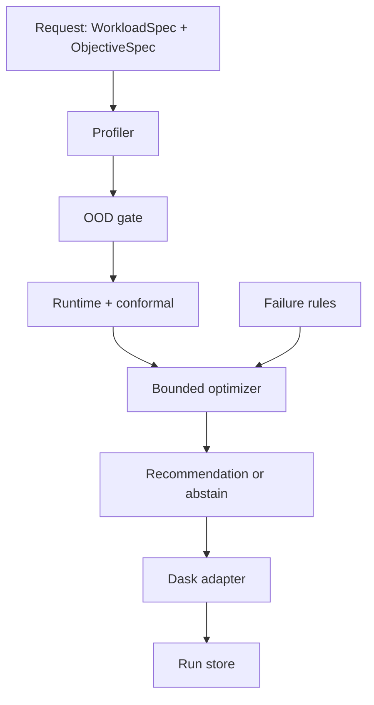

# DESIGN.md

**Updated:** 2026-10-25  
**Status:** Approved design for B-lite. Sections marked *Proposed* are not implemented.

## Goals and constraints

- Recommend or abstain **before** execution.
- Evidence from one PC; workers are memory-capped on purpose.
- Prediction uses only pre-run features.
- Complexity budget: one process, one library, no message bus.

## Architecture (approved)

Single Python package. CLI in-process. Dask `LocalCluster` is an implementation detail of the adapter.

## Components

| Component | Responsibility | Implemented? |
| --- | --- | --- |
| `schemas` | Pydantic contracts | Yes (v0) |
| `optimizer` | Feasible set + argmin cost / abstain | Yes (v0, uses supplied estimates) |
| `adapters.dask` | LocalCluster factory + smoke execute | Partial (T0 helper) |
| `workloads` | Four generators | No |
| `features` | Pre-run profiler | No |
| `models` | LightGBM, conformal, OOD | No |
| `run_store` | JSONL/Parquet append-only | No |
| `cli` | profile/train/recommend/execute | Stub |
| Glue adapter | Contract only | Out of Project-I implementation |

## Interfaces

Optimizer input: a list of `CandidateEstimate` (config id, expected runtime, conformal upper, p_fail, expected cost, ood state).  
Optimizer output: `Decision` with `action` in `{recommend, abstain}`.

SLA test uses **conformal upper bound**, not the point estimate. That is intentional conservatism.

## Data model (v0)

See `safe_pipe/schemas.py`.

Run records must store: workload id, native Dask config JSON, SLA, predicted interval, actual engine time, peak memory if available, terminal status, failure category, model version, hardware fingerprint.

## Failure taxonomy

- **Actionable:** OOM/nanny restart, excessive spill, timeout, straggler/skew.
- **Transient:** worker lost (still record; do not treat as “needs more RAM” automatically).
- **Non-configuration:** exceptions from user code, missing files.

## Security and privacy

Synthetic data only. No cloud credentials in repo.

## Performance expectations

A recommendation over 8 candidates must be < 1 s after models are loaded. Physical jobs may take minutes; that is the experiment, not a latency SLO for the optimizer.

## Testing

- Unit: schemas, optimizer feasibility, abstention on red OOD, SLA using upper bound.
- T0: one tiny Dask dataframe job under `memory_limit` (manual on experiment PC).
- Later: leakage checks; grouped split unit tests; evaluation scripts over frozen CSVs.

## Deployment

No deployment. Demo is `pytest` + one live Dask job on the experiment PC. Optional Colab notebook is not production.

## Trade-offs

- Local Dask ≠ Glue. We do not transfer claims.
- Memory cap **induces** failures; report them as induced vs natural.
- 8 candidates cannot support “optimal over all Dask knobs”. Language is **best in the declared set**.
