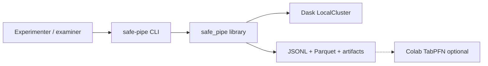
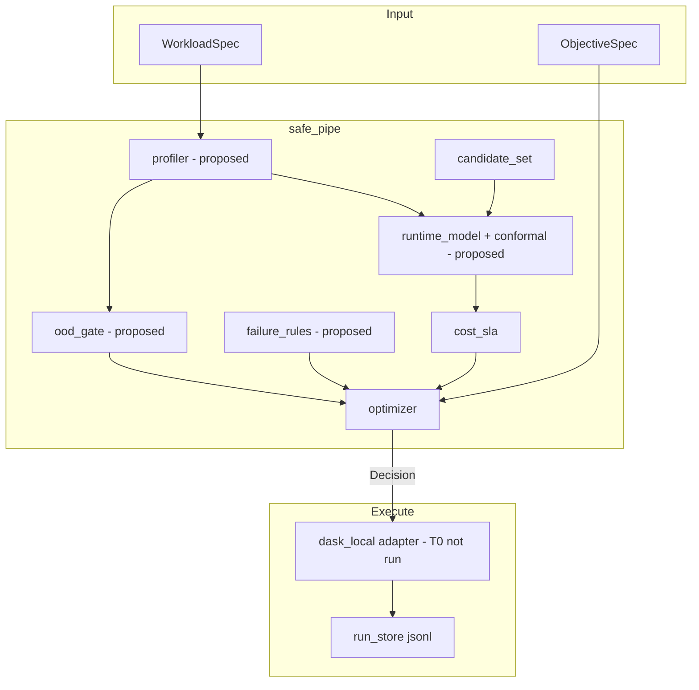

# Architecture

**Updated:** 2026-10-26  
**Status:** Approved for B-lite. Profiler, OOD, models, and Dask execute are still proposed (`execute_dask` raises `NotImplementedError` on purpose). Grid, optimizer, JSONL store, and pandas execute are implemented.  
**Companion:** [`DESIGN.md`](../DESIGN.md)

## Design constraints

- One Python package, one process, one machine per job.
- Dask is an **adapter**, not the brain.
- Prediction must not see post-run labels of the job it is scoring.
- No message queue, no REST service, no Glue runtime in Project-I.

## Context



The Mac never needs Dask for unit tests. The 16 GB PC runs `LocalCluster`. Colab reads an exported CSV only.

## Logical components



## Component contracts

### `schemas` (implemented v0)

Pydantic models in `safe_pipe/schemas.py`. `RunResult` already includes `repeat_id`, `data_version`, `hardware`, `sla_seconds`, `predicted_upper_s`, `failure_category`, `voided`, `backend`.

### `candidate_set` (implemented)

Return the eight `ConfigurationSpec` rows from a YAML/JSON frozen file `configs/dask_grid.json`. Adapter may **prune** (never add) if a combo is illegal on a host.

Allocated resources (for cost):

- `allocated_vcpus = n_workers * threads_per_worker` (honest for LocalCluster; not cloud vCPU).
- `allocated_gb` = parsed `memory_limit` × `n_workers`.

### `profiler` (proposed)

**In:** dataset path + family.  
**Out:** `WorkloadSpec` plus extra numeric features (log bytes, mean file size, partition count, skew_score, operator flags).  
**Must not include:** actual runtime, peak memory, spill bytes, status.

### `ood_gate` (proposed)

**In:** workload feature vector, training matrix, family.  
**Out:** `green | yellow | red`.

Rule of thumb (freeze thresholds on a calibration repeat, not the test family):

- red: unknown family with distance > τ_red **or** operators not in training
- yellow: in-family but near boundary or wide conformal interval later
- green: otherwise

Leave-one-family evaluation is a **report**, not a reason to drop the family from the 96-run grid.

### `runtime_model` (proposed)

Train LightGBM on `log(engine_seconds)` for `status=success` only.  
Split conformal: residual quantile on a held-out **repeat** (e.g. repeat_id=2) so repeat_id=3 can be test within family.  
**Out per candidate:** `expected_runtime_s`, `runtime_upper_s` (90%).

Median/linear baseline must be trained in the same split for the report.

### `failure_rules` (proposed)

Until 30 actionable positives:

- if `memory_limit` is 1GB **and** family in `{skewed_join, sort_merge}` → `p_fail` prior from training frequency, else 0 if never failed
- hard prune if estimated input_bytes ≫ k × allocated_gb (k from T0b, start k=4)

Do not ship a logistic head as a constraint before the gate.

### `optimizer` (implemented v0)

`recommend(estimates, objective) -> Decision`.

Feasible iff not red, `runtime_upper_s <= sla`, `p_fail <= failure_limit`.  
Pick min `(expected_cost, runtime_upper_s, config_id)`.

### `adapters.dask_local` (partial)

`cluster_kwargs`, `local_client`. Next: `submit_workload(client, family, paths, timeout_s) -> raw metrics`.

### `run_store` (implemented JSONL; Parquet compact not done)

Append-only `data/runs/runs.jsonl`. Nightly compact to `data/curated/runs.parquet`.  
Primary key: `run_id`. Never rewrite a row; add `voided=true` if a job is corrupt.

### `cli` (partial)

Today: `recommend`, `grid`, `generate` (tiny), `collect` (pandas).  
Next: Dask `execute` / matrix loop on the 16 GB PC; `train` after freeze.

## Data flow for one scored job (collection)

1. Draw `(family, config_id, repeat_id)` from shuffled matrix.
2. Build `WorkloadSpec` from **manifest** (not from the previous job’s runtime).
3. Start cluster with native kwargs. Wall-clock timeout process.
4. Run family DAG. Capture engine time, peak memory if Dask exposes it, exceptions.
5. Classify status. Write JSONL. Close cluster **fully** before the next job.

## Data flow for a recommendation (inference)

1. Profile dataset → features.
2. OOD colour.
3. For each of 8 configs, predict runtime + upper, apply rules → `CandidateEstimate` including `expected_cost = allocated_vcpus * upper_or_mean * w1 + allocated_gb * ...`.
4. **Cost uses expected runtime for the point cost, SLA uses upper bound.** Document: `expected_cost` from point estimate; constraint from upper.
5. Optimizer → Decision.
6. Optional execute.

## Trust boundary

Everything is local and synthetic. The only “unsafe” outcome is **lying in the report** (Glue numbers, leaking labels, calling 8 configs optimal).

## Error handling

| Event | Record | Next |
| --- | --- | --- |
| ValidationError | no run row | CLI exit 1 |
| Wall timeout | `timeout`, engine_seconds=limit | next job |
| KilledWorker / memory | `oom` | next job |
| Python bug in workload | `error`, notes=traceback type | fix generator; void row if systematic |
| Cluster fail to start | no row; fail the batch | T0 again |

## Expected bottlenecks

- Job runtime (minutes), not optimizer.
- Host swapping if someone sets `memory_limit` to 8GB — forbidden.
- Windows file locks on parquet — generate to a local SSD path.

## Scaling

We do not scale. We cap.

## Mapping to packages (target tree)

```
safe_pipe/
  schemas.py optimizer.py grid.py cost.py memory.py classify.py matrix.py collector.py
  adapters/dask_local.py      # LocalCluster helper; T0 not run on 16GB
  workloads/generate.py execute_pandas.py
  store/jsonl.py
  features/profiler.py        # proposed
  models/                     # proposed
configs/dask_grid.json
experiments/t0_smoke.py t0b_probe.py collect.py
data/generated/ data/runs/    # gitignored
```
