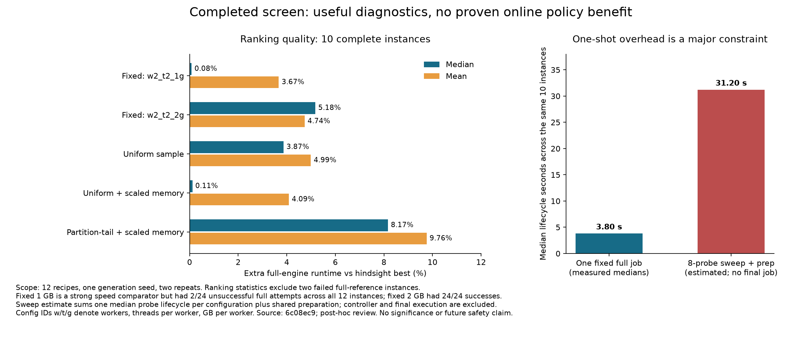

# Deep review of the completed development screen

Analysis: 2026-11-14; final review: 2026-11-15. Source: completed export at `6c08ec9`. This review runs only small local analysis over existing records. No benchmark, dataset generation or training was launched. It supplements the original report without changing its measurements or eligibility rule.

## Decision in plain language

The infrastructure works and exposes a real mismatch between small and full jobs. The present partition-tail heuristic has not earned preference as a speed-ranking method. More importantly, an eight-probe search is not economically justified for these short one-shot jobs. The next work should test a narrower claim: **can limited additional profiling identify misleading small probes and improve the speed/resource/reliability tradeoff relative to simple fixed settings?** That is a candidate question, not an established contribution.

The recommended sequence and stopping decisions are in [the follow-up plan](../../docs/research/POST_SCREEN_PLAN.md).

## Reproducible calculations

```bash
python reports/research_screen_review_20261114/analyze.py
python reports/research_screen_review_20261114/plot.py
```

The first command uses only Python's standard library and existing compact exports; the second needs matplotlib and numpy. Outputs: [analysis.json](analysis.json), [case tables](RESULTS.md), and [figure](screen_review.png). Original data stays unchanged. The script checks cell identities/counts, statuses, two repeats per group, zero recorded cleanup survivors, and every recomputed published regret. SHA-256 hashes identify its four source files. It cannot reverify the ignored Parquet/raw JSONL on Ganant's PC; that verification is recorded in the original completion audit.



## 1. What the experiment actually contains

- 768 physical attempts = 12 workload recipes × 8 target configurations × 4 methods × 2 runtime repeats.
- The 12 recipes use two families, three row counts and two patterns, all with the same generation seed (`731`). This is not 768 independent workloads or independent ML training examples.
- 759 attempts succeeded, one timed out during a power interruption, and eight had worker-death execution errors.
- All nine unsuccessful attempts are full-input jobs at 1 GB per worker, in the two largest uneven recipes. Small probes had no failures.
- Every current 2 GB target setting succeeded in all its 24 full-input attempts. That is a required empirical baseline, not proof of future safety.
- The original ranking report requires all eight candidates and both repeats to succeed. Therefore ten recipes support numerical comparisons; two difficult recipes are intentionally outside that ranking summary.

Keeping the failures outside a runtime ranking is reasonable. Forgetting them when assessing a recommendation method would introduce survivorship bias. Reliability and successful-runtime performance must both be reported.

## 2. Ranking quality: a median is not the whole result

Engine regret is selected full runtime / best observed full runtime − 1. These values use the same ten eligible recipes and two-repeat medians.

| Method / comparator | Median regret | Mean regret | Maximum regret | Full recorded outcomes of selected settings, all 12 recipes |
| --- | ---: | ---: | ---: | --- |
| Uniform | 3.87% | 4.99% | 17.37% | 1 unsuccessful / 24 replayed outcomes |
| Uniform + scaled memory | 0.11% | 4.09% | 17.37% | 3 unsuccessful / 24 replayed outcomes |
| Partition-tail + scaled memory | 8.17% | 9.76% | 23.78% | 1 unsuccessful / 24 replayed outcomes |
| Fixed `w2_t2_1g` | 0.08% | 3.67% | 17.40% | 2 unsuccessful / 24 actual full outcomes |
| Fixed `w2_t2_2g` | 5.18% | 4.74% | 13.14% | 24/24 actual full successes |

The fixed settings are post-hoc comparators, not newly validated deployed policies. The selected-outcome column replays each proxy's two-repeat-median choice against its existing two full outcomes. It is not a future failure probability or a fresh online policy evaluation. Its denominator is 24, while the regret columns cover ten recipes.

The scaled-memory method is strong on this cohort, but its worst cases remain relevant. The fixed fast 1 GB setting has a similar pattern without probing. A credible method must beat meaningful fixed baselines, not just weaker samplers.

Only two scaled-memory selected-vs-best gaps meet the existing range-separation and >5% screen. That rule is a descriptive noise filter, not a significance test. Across the ten complete recipes, the fastest full configuration changes between the two repeats in four cases. The scaled-memory proxy winner changes between repeats in six of twelve recipes. More repetitions and new seeds are needed before treating fine ranking differences as stable.

The two strongest scaled-memory regret examples are the balanced two-million-row join (17.37%) and uneven one-million-row groupby (10.50%). These are useful diagnostic cases; testing only these selected cases later would overstate generalization.

## 3. Two concrete reliability mismatches

| Recipe | Scaled-memory proxy selects | Recorded full outcomes |
| --- | --- | --- |
| Groupby, 2M rows, uneven | `w2_t2_1g` | One success, one worker-death error |
| Join, 2M rows, uneven | `w2_t1_1g` | Two worker-death errors |

For the latter join/configuration, both uniform-memory probes succeeded with no sampled spill, pauses or restarts. Their engine times were about 1.286 and 1.282 seconds. Thus **a stable, fast, spill-free small probe can coexist with failed full runs** in these records. Repeating that small probe until its timing variance looks small would not detect this fidelity bias.

The eight `KilledWorker` errors are not confirmed OOMs. Dask explains that the exception follows repeated worker deaths during a task and can have multiple causes; worker/nanny logs and process-exit evidence are needed. [Official Dask documentation](https://distributed.dask.org/en/stable/killed.html)

Only six workload/configuration groups contain execution errors, across two recipes. A seventh has the power-confounded timeout. This is inadequate diversity for a validated failure classifier. Randomly splitting the 768 rows would leak related configurations/repeats across train and test.

## 4. Is there anything useful in partition-tail?

Full jobs had sampled stored spill in 21 attempts. Uniform and uniform-memory probes had none; partition-tail had nine spill-positive attempts. Its measured speed ranking is weak, but its telemetry could potentially be useful as a diagnostic.

This is a **post-hoc observation**, not a new validated detector: grouping by workload/configuration, any tail spill flagged four of the six groups that had full execution errors; it missed two. It also flagged one group whose full repeats both completed. The power-confounded group had no tail spill. The two repeats are combined here and their profiling costs would both have to be paid by such a detector. These tiny, related counts cannot support accuracy or reliability claims.

A follow-up may test whether targeted pressure information adds value beyond a plain size/memory rule. Tail sampling should remain an ablation, not be promoted as the best method because one alternative metric looks favorable.

Input file size also differs from post-shuffle load. The generator changes hot-key probability uniformly across files; overweighting a large input file is not a direct measurement of the expensive hash bucket. Post-shuffle cardinality, dimension-table cost, concurrency and worker overhead require their own diagnostics. That is a mechanism hypothesis to test, not a causal explanation proven by this table.

## 5. Probing cost is currently a serious blocker

Across successful rows, median engine times are 1.636 s for full jobs and 1.327 s for uniform-memory probes. Median complete lifecycles are 4.055 s and 3.727 s respectively. These summaries use different successful-row cohorts; they show scale, not paired speedup.

For a matched illustrative calculation on the ten complete recipes, sum one median probe lifecycle for each of eight configurations plus shared sample preparation. Uniform-memory costs a median **31.20 s**, while one fixed `w2_t2_2g` full job costs a median **3.80 s**. The median within-recipe ratio is **8.24×**, before running the selected full job or controller. This is a constructed estimate from recorded medians, not a measured online request. It is optimistic: the reported choices use two probe repeats but this cost illustration charges only one per configuration.

An unconditional eight-probe policy cannot plausibly save one-shot latency on this tested scale. It must either skip profiling for small jobs, use very few much cheaper probes, target genuinely longer computations, or amortize profiling over explicitly recurring jobs. Recurrence is a different use case and must be declared, not assumed after seeing overhead. Do not add meaningless computation just to make probe overhead look small.

## 6. The user's objective and the current report differ

The current screen chooses fastest predicted engine runtime. The user's original preference is balanced speed and configured resource use. The old advisor already defines that preference; its weights are user choices, not coefficients to fit to benchmark winners.

Removing a common positive time reference, its default balanced score is proportional to:

`J(c) = T(c) * [0.5 + 0.25 * total_threads(c)/4 + 0.25 * total_target_memory(c)/(4 GB)]`.

As a sensitivity check only, this review chooses candidates using proxy runtime times this target-resource factor, then evaluates their recorded full balanced scores. Median/mean regrets are uniform 3.90%/13.57%, scaled-memory uniform 5.44%/7.70%, and tail 3.26%/5.33%. A fixed `w1_t2_2g` has 4.59%/6.14% with 24/24 full successes; the balanced tail choices replay three unsuccessful full outcomes. There is no decisive online winner.

This alternative ranking does **not** validate the original LightGBM advisor on the new workloads. It has no calibrated full-runtime model or deadline bound. It also does not rescue a speed claim by switching objectives after the experiment. The next study must predeclare its primary balanced objective, retain the original speed analysis as a secondary measure, and include profiling overhead and failures.

## 7. What can and cannot be claimed now

Supported: a reproducible Dask development screen, observed pressure/worker deaths in certain capped configurations, imperfect proxy fidelity, strong simple baselines, noisy short-job rankings, and substantial potential probing overhead.

Not supported: novel failure prediction, overall superiority of partition-tail, end-to-end savings, a calibrated safety guarantee, independent generalization, or paper acceptance.

The next decision is whether a limited amount of informative profiling can beat fixed/headroom baselines on new meaningful workloads. The [follow-up plan](../../docs/research/POST_SCREEN_PLAN.md) makes that a bounded feasibility question before further ML or adaptive-controller work.
